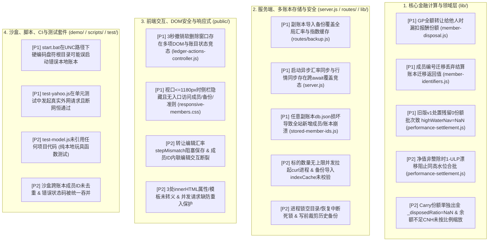

# Family Fund Manager (v4.7.2) 全量代码深度审查报告

> **审查日期**：2026-10-16  
> **审查人 / 署名**：Gemini 4 Argon  
> **覆盖范围**：核心计算引擎（`lib/`）、服务端与路由（`server.js`、`routes/`）、前端视图与控制器（`public/`）、浏览器沙盒与构建脚本（`demo/`、`scripts/`、`.github/workflows/`）、测试套件（`test/`）及治理文档对账。

---

## 总体评价

当前代码库（v4.7.2）整体工程质量扎实：
- **架构演进清晰**：已完成前端总控拆分（Controller 化）、交易服务抽离（[`lib/transaction-service.js`](../../lib/transaction-service.js)）、独立业绩结算账本（[`lib/settlement-ledger.js`](../../lib/settlement-ledger.js)）以及多账本与全盘总览架构（[`lib/ledgers.js`](../../lib/ledgers.js)、[`lib/combined-overview.js`](../../lib/combined-overview.js)）。
- **历史问题闭环良好**：`2026-10-03` 至 `2026-10-05` 审查追踪的 P0/P1 缺陷（`#1`–`#9`、`#12`、`#14`、`#15` 及 `S1`–`S4`）均已落实修复并配有回归测试。
- **本轮发现重点**：在**多账本共享状态边界**、**复杂处置/结算边缘场景（GP 自转出清退、旧版 v1 处置零份额批次、非整除净值高水位合批 ULP 漂移、编号迁移未承接结算迁移返回值）**、**前端 3 秒延迟删除竞态与移动端侧栏可达性**、以及**测试集真实外网请求与假测试**方面，共识别出 **32 项具体问题**（其中 **P1 级 10 项**、**P2 级 15 项**、**P3 级 7 项**）。



---

## 一、 核心金融计算与领域模型 (`lib/`)

### 1.1 [P1] GP 自身全额内部转让（`isSelfGp && isFullExit`）将应付业绩报酬一并转给受让方
- **位置**：[`lib/member-disposal.js`](../../lib/member-disposal.js#L98-L131)、[`lib/calculator.js`](../../lib/calculator.js#L365-L397)
- **问题分析**：
  [`disposeMemberPosition`](../../lib/member-disposal.js#L98-L106) 在处理 `isSelfGp && isFullExit` 时未区分 `withdraw`（外部出金）与 `transfer`（内部份额转让）：
  ```js
  if (isFullExit) {
    cashShares = isSelfGp
      ? sharesBefore
      : lpSharesBefore.minus(feeShares).plus(carrySharesBefore);
    ...
  }
  ...
  if (gpMember && feeShares.gt(ZERO) && !(isSelfGp && isFullExit)) {
    gpMember.shares = gpMember.shares.plus(feeShares);
    gpMember.carryShares = gpMember.carryShares.plus(feeShares);
  }
  ```
  - 当 GP **全额出金**（`withdraw`）时，出金人与 GP 为同一人，将 LP 份额与结晶报酬合并作为出金现金流一并提走是合理的（符合治理准则 09）。
  - 但当 GP 向另一名成员（如 `Alice`）发起**全额内部转让**（`event.type === 'transfer'`）时，`cashShares` 被设为 `sharesBefore`（未扣除 `feeShares`），且第 128 行跳过了向 GP 记入 `carryShares`。结果是受让方 `Alice` 获得了 GP 100% 的毛份额（包含本应结晶给 GP 的业绩报酬份额），而流水事件上的 `_performanceFee` 和 `_performanceFeeShares` 却仍然显示收取了业绩报酬，违反了治理准则 08。
- **修复建议**：仅在 `event.type === 'withdraw' && isSelfGp && isFullExit` 时合并 `cashShares = sharesBefore`；当 `event.type === 'transfer'` 时，即便转出方是 GP 本人，也应扣减 `feeShares` 并留存于 `gpMember.carryShares`，仅将净份额转入 `toMember`。

---

### 1.2 [P1] `renameMemberIdentifiers` 丢弃了 `migrateSettlementLedger` 的返回值，遇到未标记 `algorithmVersion` 的历史结算直接崩溃
- **位置**：[`lib/member-identifiers.js`](../../lib/member-identifiers.js#L38-L57)、[`lib/settlement-ledger.js`](../../lib/settlement-ledger.js#L115-L203)
- **问题分析**：
  [`migrateSettlementLedger(db, ledger)`](../../lib/settlement-ledger.js#L115) 是纯函数，会克隆 `ledger` 并在返回值 `{ ledger, migrated, migratedCount }` 中补齐历史结算记录的 `algorithmVersion`，**不会原地修改传入的 `ledger` 参数**。
  然而 [`renameMemberIdentifiers`](../../lib/member-identifiers.js#L40-L56) 写了：
  ```js
  migrateSettlementLedger(db, ledger);
  ...
  migrateSettlementLedger(nextDb, nextLedger);
  const before = remapReferences(calculateStateFromDb(mergeSettlementLedger(clone(db), clone(ledger))), mapping);
  ```
  两次调用的返回值均被丢弃，紧接着把未迁移 `algorithmVersion` 的原 `ledger` / `nextLedger` 传给 `calculateStateFromDb`，触发 [`lib/performance-settlement.js`](../../lib/performance-settlement.js#L301) 抛出 `Error('业绩结算记录缺少算法版本，必须先完成安全迁移。')`；且第 56 行返回的也是未写入 `algorithmVersion` 的 `nextLedger`。
- **修复建议**：接收返回值 `const migratedBefore = migrateSettlementLedger(db, ledger).ledger;` 与 `const migratedAfter = migrateSettlementLedger(nextDb, nextLedger).ledger;`，并在后续重放及返回中使用迁移后的账本。

---

### 1.3 [P1] 旧版处置（`legacyDisposal`）保留 0 份额批次，导致 `lpLedger` 中 `highWaterNav: NaN`（JSON 序列化为 `null`）
- **位置**：[`lib/performance-settlement.js`](../../lib/performance-settlement.js#L384-L390)、[`lib/calculator.js`](../../lib/calculator.js#L597-L604)、[`lib/performance-settlement.js`](../../lib/performance-settlement.js#L38-L53)
- **问题分析**：
  当 `legacyDisposal === true`（`disposalVersion === 1` 或缺省）且成员全额退出或耗尽某批次时，[`previewDisposalFee`](../../lib/performance-settlement.js#L384) 因为 `if (!remainingShares.isZero() || legacyDisposal)` 会将 `shares: Decimal(0), basis: Decimal(0)` 的空批次保留在 `member.lots` 中。
  虽然 `snapshotHighWater` 和 `settlePerformanceV2/V3` 过滤了 0 份额批次，但以下三处未过滤：
  1. [`lib/calculator.js`](../../lib/calculator.js#L597-L604) 生成 `computedMembers[k].lpLedger` 时直接计算 `lot.basis.div(lot.shares)`（即 `0 / 0 = NaN`），导致接口返回的 `lpLedger` 中出现 `{ shares: 0, basis: 0, highWaterNav: null }` 僵尸批次；
  2. [`settlePerformanceV1`](../../lib/performance-settlement.js#L47) 计算 `entryNav: output(lot.basis.div(lot.shares), 12)` 同样产生 `NaN`；
  3. [`calculator.js`](../../lib/calculator.js#L458-L461) 的 `finalActiveLotCount` / `peakActiveLotCount` 统计包含了已耗尽的 0 份额批次。
- **修复建议**：在 `computedMembers[k].lpLedger`、`settlePerformanceV1` 及活跃批次统计中过滤 `lot.shares.gt(ZERO)`（或移除 `|| legacyDisposal` 对 0 份额批次的保留，若无锁定快照依赖空批次）。

---

### 1.4 [P2] `settlePerformanceV3` 因 `lot.basis.div(lot.shares)` 的末位舍入（1 ULP）导致同高水位批次无法合并
- **位置**：[`lib/performance-settlement.js`](../../lib/performance-settlement.js#L226-L278)
- **问题分析**：
  当成员在非有限小数净值（如 `currentNAV = 7` 或 `1.03`）下多次入金时，`sharesGained = amount.div(currentNAV)` 在第 40 位有效数字可能向下舍入。此时反算 `priorHighWaterNav = lot.basis.div(lot.shares)` 会得到 `currentNAV + 1e-39`（比 `currentNAV` 大 1 ULP）。
  在结算时：
  1. `Decimal.max(priorHighWaterNav, currentNAV)` 会取 `priorHighWaterNav`（`7.000...001`）而非 `currentNAV`（`7`）；
  2. 第 265 行 `const allLotsAtCurrentHigh = settledLots.every(lot => lot.basis.eq(lot.shares.mul(currentNAV)));` 判定为 `false`，导致本应合并的同高水位批次未能合并为单条 `settlement_reset` 批次（违反治理准则 06）。
  3. 当存在多批次分别扣减 `lotFeeShares` 时，逐批 `sharesAfter` 之和与汇总 `lpShares.minus(feeShares)` 可能产生 1 ULP 偏差。
- **修复建议**：在批次对象上显式记录精确的 `highWaterNav`（入金时为 `currentNAV`，结晶提升时更新为 `currentNAV`），或对 `priorHighWaterNav` 与 `currentNAV` 的比较引入合理的容差（如 `1e-35`），并在合批/分批后对齐 `member.lpShares` 与 `member.shares`。

---

### 1.5 [P2] 其它核心计算边界与模块一致性问题
1. **仅持有 Carry 份额的成员在旧版/无 GP 出金时 `_disposedRatio` 为 `NaN`**：
   - [`lib/calculator.js`](../../lib/calculator.js#L303-L310)（`withdraw` 分支）缺少 [`transfer` 分支](../../lib/calculator.js#L401) 的 `disposed.lpSharesBefore.isZero() ? ZERO : ...` 保护。当 `lpSharesBefore === 0` 且 `carrySharesBefore > 0` 时，`disposed.lpSharesDisposed.div(disposed.lpSharesBefore)` 触发 `0 / 0 = NaN`。
2. **非全额出金/转让在份额不足被截断时未等比例缩放 `eventCnhAmount`**：
   - [`lib/member-disposal.js`](../../lib/member-disposal.js#L51-L93)：第 51 行先执行了 `let cashShares = Decimal.min(requestedAmount.div(currentNAV), sharesBefore)`，导致当 `fee === 0` 或 `!usesNetDisposal` 时，第 86 行的 `if (cashShares.gt(availableCashShares))` 恒为 `false`，`eventCnhAmount` 未按 `actualAmount.div(requestedAmount)` 缩放；且 [`calculator.js`](../../lib/calculator.js#L367) 在 `transfer` 的 `sharesBefore === 0` 时仍累加了全额人民币 `eventCnhAmount`。
3. **旧版 v1 处置（`usesNetDisposal === false`）在产生业绩报酬时少扣减了 `remainingPrincipal`**：
   - [`lib/calculator.js`](../../lib/calculator.js#L277-L280) 与 [`L358-L361`](../../lib/calculator.js#L358-L361)：v1 模式下 `disposed.disposal.ratio` 仅代表现金份额占比 `lpSharesDisposed / lpSharesBefore`，未包含从剩余份额中额外划扣给 GP 的 `feeShares`，导致全部 LP 份额被耗尽时 `remainingPrincipal` 仍残留非零值。
4. **`combined-overview.js` 空账本总览收益率返回 `null` 而非 `0`，且成员排序受结算快照 `lpMembers` 干扰**：
   - [`lib/combined-overview.js`](../../lib/combined-overview.js#L22-L28)：`summary.profitRate` 和 `summary.cnhProfitRate` 调用 `rate(...)` 时未传第 3 参数 `empty = 0`，导致 `totalDeposit === 0` 时返回 `null`（与 `calculator.js` 返回 `0` 不一致）。
   - [`lib/combined-overview.js`](../../lib/combined-overview.js#L32-L37)：`firstRecord` 将结算事件上的 `...(event.lpMembers || [])`（包含所有未入金的空户成员）计入了首次活跃顺序，导致零资产空户排在其他账本真实出资成员之前；且跨账本事件排序仅用了 `a.date.localeCompare(b.date)` 而非 `compareEvents`。
5. **成员 6 位数字编号正则不一致**：
   - [`lib/member-id.js`](../../lib/member-id.js#L5) 与 [`lib/member-identifiers.js`](../../lib/member-identifiers.js#L6) 要求 `/^[1-9][0-9]{5}$/`（首位非 0），但 [`routes/members.js`](../../routes/members.js#L69) 和 [`L111`](../../routes/members.js#L111) 使用 `/^[0-9]{6}$/`，允许改成 `000000` 或 `012345`。
6. **`memberPotentialFees` 默认使用实时 `new Date()` 且 `_stateCache` 跨午夜不失效**：
   - [`lib/calculator.js`](../../lib/calculator.js#L533-L535) 在未传 `options.asOf` 时读取当前北京时间日期；[`server.js`](../../server.js#L288-L295) 的 `_stateCache` 未感知跨日变化，长时间运行的服务在次日仍返回前一天的 `asOf` 与门槛收益预估。
7. **`settlePerformanceV2` / `V3` 对同一批次重复计算 3~4 次 40 位精度幂运算 `hurdleValue`**：
   - [`lib/performance-settlement.js`](../../lib/performance-settlement.js#L116-L163) 及 [`L220-L255`](../../lib/performance-settlement.js#L220-L255) 在 `map` 中已算出 `lotHurdle` 和 `lotExcess`，随后又执行两次 `.reduce` 重新调用 `hurdleValue`，可直接复用单次遍历结果。

---

## 二、 服务端、多账本存储、并发与安全 (`server.js`, `routes/`, `lib/`)

### 2.1 [P1] 在副账本（`ledger-2` 等）导入备份会覆盖全局共享的汇率缓存与指数缓存
- **位置**：[`routes/backup.js`](../../routes/backup.js#L190-L200)、[`routes/backup.js`](../../routes/backup.js#L312-L330)、[`lib/ledgers.js`](../../lib/ledgers.js#L20-L27)、[`demo/browser/sandbox.js`](../../demo/browser/sandbox.js#L85-L95)
- **问题分析**：
  多账本设计中（[`lib/ledgers.js`](../../lib/ledgers.js#L24-L26)），副账本的 `store.writeSnapshot` 特意忽略了导入的 `_config` 以保护全局配置不被副账本恢复覆盖。然而在 [`routes/backup.js`](../../routes/backup.js#L317-L329) 中，`writeSnapshot` 之后紧接着无条件执行了：
  1. `writeCnhRate(importedCnhRate, { source: 'backup-import' })`：若旧版备份含有 `cnhRate`，在 `ledger-2` 导入会直接改写全局 `data/cnh-rate-cache.json`；
  2. `writeIndexCache(importedIndexCache)`：若备份含有 `indexCache`，不仅未按日期合并（`{ ...readIndexCache(), ...importedIndexCache }`），反而**整表替换**了全局共享的 `data/index-cache.json`，清空其他账本所需的历史指数缓存；
  3. `void queueTickerRefresh(importedConfig)`：副账本并未保存 `importedConfig`，却用未生效的 `importedConfig` 触发了全局 `ticker-cache.json` 刷新。
- **修复建议**：
  - 将 `importedIndexCache` 改为与现有 `readIndexCache()` 合并写入，并对 `importedIndexCache` 的键值结构（`YYYY-MM-DD -> { VOO, QQQM }`）进行校验（当前 [`routes/backup.js`](../../routes/backup.js#L198-L200) 完全未校验 `indexCache` 内部结构，深层嵌套对象甚至可在 [`lib/storage.js`](../../lib/storage.js#L206-L221) 引发递归栈溢出）；
  - 副账本导入时跳过覆盖全局 `cnhRate`（除非全局尚无汇率）并使用 `readConfig()` 触发行情刷新。

---

### 2.2 [P1] 启动异步汇率同步与 `syncBenchmarkHistory` 存在跨 `await` 状态覆盖竞态
- **位置**：[`server.js`](../../server.js#L359-L424)、[`server.js`](../../server.js#L499-L508)
- **问题分析**：
  1. **汇率启动同步覆盖手动/导入汇率**（[`server.js`](../../server.js#L499-L508)）：服务启动时异步调用 `fetchCnhRateFromApi()`（最多顺序尝试 4 个源，耗时可达数秒至数十秒）。在此期间若用户通过 `POST /api/settings` 手动修改汇率或导入备份，待启动同步返回后会无条件调用 `writeCnhRate(rate, { source: 'startup-sync' })` 覆盖用户刚设置的汇率。
  2. **基准行情同步覆盖最新配置与行情**（[`server.js`](../../server.js#L363-L419)）：`syncBenchmarkHistory` 在 `await Promise.all(... fetchYahooPrices ...)` **之前**读取了 `config = storage.readConfig()` 和 `history = normalizeMarketHistory(storage.readMarketHistory())`。在等待 Yahoo 响应期间，若用户修改或删除了自定义基准（`POST /api/settings/custom-benchmark`），网络请求完成后仍使用旧的 `customBenchmarks` 快照重新生成并写回 `custom-benchmark-cache.json`。
- **修复建议**：
  - 启动汇率同步回调写入前检查 `storage.readCnhRateCache().updatedAt` 是否在启动后已被更新；
  - `syncBenchmarkHistory` 在 `await Promise.all(...)` 完成后重新读取最新的 `storage.readConfig()` 与 `storage.readMarketHistory()` 再执行合并与落盘。

---

### 2.3 [P1] [`lib/stored-member-ids.js`](../../lib/stored-member-ids.js) 缺少异常隔离且硬编码默认存储路径
- **位置**：[`lib/stored-member-ids.js`](../../lib/stored-member-ids.js#L4-L11)、[`server.js`](../../server.js#L452)
- **问题分析**：
  1. `storedMemberIds(root)` 遍历所有 `ledger-*` 目录并直接执行 `JSON.parse(fs.readFileSync(file, 'utf8'))`。如果任意一个副账本目录（甚至是未完成创建的残留目录）下的 `db.json` 损坏，未捕获的 `SyntaxError` 会导致主账本和所有其他账本的 `POST /api/members`（新增成员）以及 `POST /api/ledgers`（新建账本）全部 500 报错。
  2. [`server.js`](../../server.js#L452) 将 `getStoredMemberIds` 硬编码为 `path.dirname(defaultStorage.DB_FILE)` 而非当前传入 `createLedgerApplication(storage)` 的 `storage.DB_FILE`。
  3. 对每个子目录重复调用了两次 `fs.lstatSync`。

---

### 2.4 [P2] 服务端与存储层其它重要问题
1. **标的数量无上限与无限制并发 `curl` 进程（DoS 隐患）**：
   - [`routes/tickers.js`](../../routes/tickers.js#L206-L222) 与 [`routes/backup.js`](../../routes/backup.js#L294-L305) 未限制 `tickers` 数组最大长度（且 `routes/tickers.js` 未校验重复标的）。[`lib/yahoo.js`](../../lib/yahoo.js#L181) 直接对所有标的执行无并发限制的 `Promise.all`，在代理模式或 `curl` 回退下会瞬间拉起同等数量的 `curl` 子进程。建议限制 `tickers.length <= 50` 并增加并发度控制。
2. **`PUT /api/members` 绕过了 `server.js` 的延迟结算账本迁移**：
   - [`routes/members.js`](../../routes/members.js#L59) 直接调用 `deps.readBaseDb?.()`（即 `storage.readDb()`），若此时 `_settlementLedgerValidated` 仍为 `false`（如 `FUND_EXTERNAL_SYNC=0` 启动后首次请求即为 `PUT /api/members`），会跳过 `server.js:153-193` 的旧版内嵌结算拆分与顺序号迁移。應先调用一次 `readDb()` 确保迁移完成。
3. **数据目录锁（`data-directory-lock.js`）崩溃恢复死锁边界与写前删备份风险**：
   - [`lib/data-directory-lock.js`](../../lib/data-directory-lock.js#L60-L67)：若进程在 `mkdirSync(lockPath)` 后、`writeFileSync(ownerPath)` 前被强杀，空锁目录因缺少 `owner.json` 导致下次启动 `recoverDeadLocalOwner` 读取报 `ENOENT` 返回 `false`，无法自愈；同理 `.recovery` 目录残留也会永久阻断恢复。
   - [`lib/storage.js`](../../lib/storage.js#L441-L446) 与 [`L510-L529`](../../lib/storage.js#L510-L529)：`writeCoreBackup` 在 `atomicWriteFile` **之前**执行并删除第 16 个旧备份。若主文件原子重命名在 Windows 下因杀毒软件/索引占用连续失败 15 次，所有历史有效备份会被未提交状态的备份全部挤掉。
4. **处置试算 `previewToken` 未绑定请求参数**：
   - [`lib/transaction-service.js`](../../lib/transaction-service.js#L17-L25) 的 `ledgerToken(db)` 仅对账本状态计算 HMAC，未像 [`routes/settlements.js`](../../routes/settlements.js#L14-L21) 那样将试算输入参数（成员、日期、金额、币种汇率）纳入签名并使用 `timingSafeEqual`。
5. **`localRequestPolicy` 拦截外部链接顶层导航（`GET /`、`GET /demo`）及 HTTPS 443 默认端口问题**：
   - [`lib/local-request-policy.js`](../../lib/local-request-policy.js#L29-L30)：当用户从外部文档/聊天软件点击 `http://localhost:3000/` 链接时，浏览器发送 `Sec-Fetch-Site: cross-site` 且 `Sec-Fetch-Mode: navigate`，被全局中间件直接返回 `403` JSON；此外第 8 行 `Number(match[2] || 80) !== port` 在加密连接默认 443 端口未显式带 `:443` 时会误判。
6. **`curlJson` 缺少重定向协议限制**：
   - [`lib/http-json.js`](../../lib/http-json.js#L73-L89) 使用了 `-L` 跟随重定向，建议补充 `'--proto', '=https', '--proto-redir', '=https'` 及 `'--'` 参数分隔符。
7. **`routes/demo.js` 的 `/api/demo/settings/custom-benchmark` 忽略了当前选中的演示账本**：
   - [`routes/demo.js`](../../routes/demo.js#L69-L73) 固定读取 `demoLedger`（第一个演示账本）而未调用 `selectedLedger(req)`，且演示接口每次请求仍重复全量重放不可变的演示数据（历史遗留项 `#10`）。

---

## 三、 前端架构、交互控制与样式 (`public/`)

### 3.1 [P1] 流水 3 秒延迟删除（Soft-Delete Undo）存在多项异步竞态与状态撕裂
- **位置**：[`public/js/ledger-actions-controller.js`](../../public/js/ledger-actions-controller.js#L8-L92)
- **问题分析**：
  点击删除流水时，前端仅将当前 DOM 行设为 `opacity: 0.2; pointer-events: none`，等待 `3000ms` 后才调用 `api.deleteEvent(id)`：
  1. **筛选切换或后台刷新导致待删行“复活”且撤销失效**：在 3 秒倒计时内，若用户切换成员/类型筛选，或后台基准轮询触发 `loadAllData()`，表格会执行 `ledgerTbody.replaceChildren()` 重绘。由于服务端尚未删除该记录，该行会以正常状态重新渲染出来（可再次点击删除或编辑），而原 `targetRow` 变成脱离 DOM 树的孤儿节点，此时点击 Toast 上的“撤销”无法恢复新行，不点撤销则会在第 3 秒突然删除。
  2. **连续删除两条记录时闪烁回跳**：`t=0s` 删第 1 行，`t=2s` 删第 2 行；`t=3s` 第 1 行删除完成并触发 `loadAllData()`，导致仍在倒计时的第 2 行恢复完全高亮显示 1 秒，到 `t=5s` 才真正消失。
  3. **3 秒窗口内提交新交易/结算基于删除前旧账目计算**：用户删除错误估值或出入金后立即在 3 秒内提交新交易或结算，此时删除请求尚未发往后端，后端仍按未删除前的账本状态执行写入！
- **修复建议**：维护一个模块级 `pendingDeleteIds = new Set()`（以及 `flushPendingDeletes()` 队列）：
  - `ledger-renderer.js` 渲染时若 `pendingDeleteIds.has(e.id)` 则自动保持半透明禁用样式，撤销时根据 `id` 重新查找当前 DOM 行恢复；
  - 在发起任何新的写操作、试算、结算或切换账本前，立即 flush（提交）所有待执行的删除请求。

---

### 3.2 [P1] 响应式断点 `<= 1180px` 下侧栏完全隐藏，成员设置/数据备份/管理准则无任何入口
- **位置**：[`public/css/responsive-members.css`](../../public/css/responsive-members.css#L1-L5)、[`public/js/ledger-switcher.js`](../../public/js/ledger-switcher.js#L88-L94)
- **问题分析**：
  当浏览器宽度 `<= 1180px`（平板、手机或分屏桌面窗口）时，`.app-sidebar` 被设为 `display: none`。虽然 `ledger-switcher.js` 将 `#ledger-switcher` 动态移入了 `.app-header`，但侧栏中的**成员设置**（`[data-sidebar-action="members"]`）、**数据备份/恢复**（`[data-sidebar-action="backup"]`）、**基金管理准则**（`[data-sidebar-action="principles"]`）在窄屏下没有任何顶部按钮或抽屉菜单入口，功能完全不可达。
- **修复建议**：在 `.app-header` 中提供移动端菜单触发器或操作按钮组，或在窄屏下将 `.app-sidebar` 改为可展开抽屉/底部导航。

---

### 3.3 [P2] 前端交互逻辑、DOM 安全与并发控制问题
1. **编辑转让流水时反算汇率未四舍五入，触发 HTML5 `step="0.0001"` 校验阻塞保存**：
   - [`public/js/ledger-actions-controller.js`](../../public/js/ledger-actions-controller.js#L151-L154)：当历史转让记录未存 `cnhRate` 时，使用 `e.cnhAmount / e.amount` 计算出的浮点数可能超过 4 位小数（如 `7.200460829...`），填入 `<input id="edit-cnh-rate" step="0.0001">` 后直接导致表单无法提交。应改为 `Number((e.cnhAmount / e.amount).toFixed(4))`。
2. **成员管理弹窗中内联编辑成员编号（ID）交互不完整**：
   - [`public/js/member-editor-controller.js`](../../public/js/member-editor-controller.js#L154-L186)：点击成员 ID 旁的“编辑”按钮（`#member-id-save-${m.id}`）只显示了 `idInput`，**没有显示保存勾号按钮 `btnSave`**，且 `idInput` 未绑定 `Enter`/`Escape` 键盘事件，`cancelEdit()` 也未重置 `idInput`。
3. **编辑流水弹窗（`#edit-member`）未过滤非 LP 成员，且主表单切换 LP 角色后可能残留空选中值**：
   - [`public/js/app.js`](../../public/js/app.js#L506-L545)：`#tx-member` 仅填充 `lpMembers`，但 `#edit-member` 填充了全部成员（含纯 GP 成员）；且第 511 行 `if (savedTxVal && membersList.some(m => m.id === savedTxVal))` 检查的是 `membersList` 而非 `lpMembers`。
4. **3 处 `innerHTML` 未对动态属性或字段做 HTML 转义（DOM XSS 防御缺口）**：
   - [`public/js/member-editor-controller.js`](../../public/js/member-editor-controller.js#L45-L76)：10 处 `id="...-${m.id}"` 属性未对 `m.id` 调用 `escapeHtml`；
   - [`public/js/ledger-actions-controller.js`](../../public/js/ledger-actions-controller.js#L38-L41)：`id="undo-btn-${id}"` 与 `id="undo-progress-${id}"` 未转义 `id`；
   - [`public/js/member-statement-controller.js`](../../public/js/member-statement-controller.js#L51-L71)：日期与月份字符串拼入 `innerHTML` 时未使用 `escape()`。
5. **前端并发与防重入遗漏**：
   - [`public/js/management-controller.js`](../../public/js/management-controller.js#L15)：`if (newMemberName.disabled) return;` 检查了 `disabled`，但提交过程中从未将 `newMemberName.disabled` 设为 `true`；
   - [`public/js/custom-benchmark-controller.js`](../../public/js/custom-benchmark-controller.js#L223-L254)：快速先后点击基准槽位 0 和槽位 1 的配置按钮时，先发出的请求若后返回，会将槽位 0 的数据填入 `activeSlot = 1` 的弹窗中；
   - [`public/js/app.js`](../../public/js/app.js#L465-L503)：`loadAllData()` 仍串行请求 `getMembers()` 和 `getState()`（历史遗留项 `#13`），且缺少请求序号保护，后台轮询与用户切账本并发调用时可能发生旧响应覆盖新状态。
6. **每次渲染图表时 `ChartRenderer.render()` 后立即调用 `updateTheme()` 触发二次重绘并覆盖悬停边框样式**：
   - [`public/js/app.js`](../../public/js/app.js#L703-L707) 与 [`public/js/chart-renderer.js`](../../public/js/chart-renderer.js#L450-L496)：`render()` 刚创建的白色 `pointHoverBorderColor: '#ffffff'` 和透明度渐变被紧随其后的 `updateTheme()` 覆盖为 `'transparent'`，且导致 Chart.js 每次渲染执行两次 `.update()`。

---

## 四、 沙盒演示、构建脚本、CI/CD 与测试套件 (`demo/`, `scripts/`, `test/`)

### 4.1 [P1] [`start.bat`](../../start.bat#L14-L19) 在 UNC 网络共享路径下硬编码盘符根目录，可能静默启动错误的本地账本
- **位置**：[`start.bat`](../../start.bat#L14-L19)
- **问题分析**：
  ```bat
  echo "!SCRIPT_DIR!" | findstr /b "\\\\" >nul && (
      for %%D in (Z Y X W V U T S R Q P O N M L K J I H G F E D C) do (
          if not defined WORK_DIR if exist "%%D:\family-fund-manager\package.json" (
              cd /d "%%D:\family-fund-manager" 2>nul && set "WORK_DIR=!CD!"
          )
      )
  )
  ```
  当用户从 NAS 的 UNC 路径双击 `start.bat` 时，脚本从 `Z:` 到 `C:` 扫描是否存在 `%%D:\family-fund-manager\package.json`：
  1. 如果本机某盘（如 `D:\family-fund-manager`）恰好有一个旧版或测试版副本，从 NAS 启动时会**静默切换到本机旧副本并读写错误的数据目录**；
  2. 如果映射网络驱动器的路径在子目录下（如 `Z:\code\family-fund-manager`），该逻辑无法命中。

---

### 4.2 [P1] 单元测试 [`test/test-yahoo.js`](../../test/test-yahoo.js#L118-L125) 发起真实外网请求且断网时断言恒通过
- **位置**：[`test/test-yahoo.js`](../../test/test-yahoo.js#L118-L125)
- **问题分析**：
  尽管 [`scripts/run-tests.js`](../../scripts/run-tests.js#L76) 设置了 `FUND_EXTERNAL_SYNC: '0'`，但 `test-yahoo.js` 直接调用了 `await fetchCnhRateFromApi()`，在每次运行 `npm test` 时都会向 `open.er-api.com`、`cdn.jsdelivr.net`、`api.frankfurter.app`、`query1.finance.yahoo.com` 发起真实网络请求（及 `curl` 进程）；而且断言写的是 `rate === null || ...`，在无网环境下耗尽超时后返回 `null` 依然算通过，既拖慢测试又未真正验证汇率解析与降级逻辑。

---

### 4.3 [P2] 沙盒、脚本与测试的其它问题
1. **无效测试文件 [`test/test-model.js`](../../test/test-model.js#L1-L147)**：
   - 该测试文件只 `require('assert')`，内部自己定义了一个 90 行的浮点数玩具函数 `runSimulation`，**完全没有引入任何项目源码**（即便把 `lib/calculator.js` 删掉该测试依然通过），建议移除或改为调用 `calculateStateFromDb`。
2. **浏览器沙盒（`demo/browser/sandbox.js`）与服务端行为偏差**：
   - [`demo/browser/sandbox.js`](../../demo/browser/sandbox.js#L71-L109) 与 [`L142-L145`](../../demo/browser/sandbox.js#L142-L145)：未向 `registerApiRoutes` 传入 `getStoredMemberIds`，且新建账本时 `const used = new Set()` 为空集，导致沙盒中跨账本成员编号可能冲突；
   - [`demo/browser/sandbox.js`](../../demo/browser/sandbox.js#L193-L201)：丢弃了路由返回的 HTTP 状态码与 `code`，将 `ConflictError`（409）、`NotFoundError`（404）全部包装成了 `InputError`（400）。
3. **打包脚本仓库地址过期及 Windows 打包未过滤敏感目录**：
   - [`一键打包.command`](../../%E4%B8%80%E9%94%AE%E6%89%93%E5%8C%85.command#L111) 与 [`一键打包.bat`](../../%E4%B8%80%E9%94%AE%E6%89%93%E5%8C%85.bat#L104) 仍打印旧仓库地址 `github.com/kamen-exaid/family-fund-manager`（应为 `spicy-man/family-fund-manager`）；且 `一键打包.bat` 遍历 `git ls-files` 时缺少 `一键打包.command` 中的 `data/*|backups/*|.env*` 排除规则。
4. **CLI 脚本 [`scripts/migrate-member-identifiers.js`](../../scripts/migrate-member-identifiers.js#L6-L15) 在参数校验前获取目录锁**：
   - 第 6 行加载 `storage` 即获取锁，若第 9–11 行 `--mapping` 参数缺失或文件不存在，在进入第 13 行 `try / finally` 前抛出异常退出。
5. **CI 缺少 PR 自动验证工作流 & 文档部分滞后**：
   - `.github/workflows/` 仅在 `push: main` 和 `push: tags: ['v*']` 触发，缺少 `pull_request` 触发器；
   - [`README.md`](../../README.md#L73) 仍描述沙盒仅支持 `AAPL、GOOGL、VGT`（实际 v4.0.3 已支持全部 20 只标的）；[`docs/technical/CODE_REVIEW.md`](../../docs/technical/CODE_REVIEW.md#L3) 停留在 v4.0.1（2026-10-05）。

---

## 五、 优先级汇总与修复路线建议

| 优先级 | 编号 | 模块 | 问题简述 | 关键文件 |
| :--- | :--- | :--- | :--- | :--- |
| **P1** | **D-1** | 核心计算 | GP 全额内部转让（`isSelfGp && isFullExit`）未扣除应付业绩报酬份额，导致报酬份额被转给受让方 | [`lib/member-disposal.js`](../../lib/member-disposal.js#L98-L131) |
| **P1** | **D-2** | 核心领域 | `renameMemberIdentifiers` 丢弃 `migrateSettlementLedger` 返回值，遇旧版无版本号结算记录直接抛错中断 | [`lib/member-identifiers.js`](../../lib/member-identifiers.js#L38-L57) |
| **P1** | **D-3** | 核心计算 | `legacyDisposal` 保留 0 份额批次，导致 `lpLedger` 与 `settlePerformanceV1` 出现 `highWaterNav: NaN` (`null`) | [`lib/performance-settlement.js`](../../lib/performance-settlement.js#L384-L390), [`lib/calculator.js`](../../lib/calculator.js#L597-L604) |
| **P1** | **B-1** | 备份恢复 | 副账本导入备份会覆盖全局共享的汇率缓存并整表替换全局指数缓存，且 `indexCache` 缺少结构校验 | [`routes/backup.js`](../../routes/backup.js#L198-L200), [`routes/backup.js`](../../routes/backup.js#L317-L330) |
| **P1** | **B-2** | 并发同步 | 启动异步汇率同步与 `syncBenchmarkHistory` 存在跨 `await` 覆盖用户新配置/手动汇率的竞态 | [`server.js`](../../server.js#L359-L424), [`server.js`](../../server.js#L499-L508) |
| **P1** | **B-3** | 多账本存储 | `stored-member-ids.js` 未捕获单账本 JSON 损坏异常且硬编码默认路径，任一 `db.json` 损坏致全局新增成员/账本崩溃 | [`lib/stored-member-ids.js`](../../lib/stored-member-ids.js#L4-L11), [`server.js`](../../server.js#L452) |
| **P1** | **F-1** | 前端交互 | 流水 3 秒撤销软删除窗口在筛选/刷新/连续删除/立即新增交易时产生 DOM 孤儿节点与删除前状态写入竞态 | [`public/js/ledger-actions-controller.js`](../../public/js/ledger-actions-controller.js#L8-L92) |
| **P1** | **F-2** | 响应式 UI | 宽度 `<= 1180px` 时侧栏隐藏，成员设置、数据备份、管理准则无任何触发入口 | [`public/css/responsive-members.css`](../../public/css/responsive-members.css#L1-L5) |
| **P1** | **T-1** | 启动脚本 | `start.bat` 在 UNC 路径下扫描 `C:`~`Z:` 根目录 `family-fund-manager`，可能误启动本机其它旧账本 | [`start.bat`](../../start.bat#L14-L19) |
| **P1** | **T-2** | 测试套件 | `test-yahoo.js` 在单测中发起真实外网请求且离线返回 `null` 恒通过 | [`test/test-yahoo.js`](../../test/test-yahoo.js#L118-L125) |
| **P2** | **D-4** | 核心计算 | `settlePerformanceV3` 因 `lot.basis.div(lot.shares)` 1-ULP 舍入偏差阻止同高水位批次合并 | [`lib/performance-settlement.js`](../../lib/performance-settlement.js#L226-L278) |
| **P2** | **D-5** | 核心计算 | 纯 Carry 份额出金 `_disposedRatio: NaN`；份额不足截断时 `eventCnhAmount` 未按比例缩放；v1 处置少扣 `remainingPrincipal` | [`lib/calculator.js`](../../lib/calculator.js#L277-L310), [`lib/member-disposal.js`](../../lib/member-disposal.js#L51-L93) |
| **P2** | **D-6** | 全盘总览 | `combined-overview.js` 空账本总收益率为 `null` 而非 `0`；成员排序将结算快照 `lpMembers` 空户计为活跃记录 | [`lib/combined-overview.js`](../../lib/combined-overview.js#L20-L37) |
| **P2** | **B-4** | 接口校验 | 标的配置无数量上限与并发限制；成员编号正则前后端不一致；`PUT /api/members` 绕过延迟结算迁移 | [`routes/tickers.js`](../../routes/tickers.js#L206-L222), [`routes/members.js`](../../routes/members.js#L59-L111) |
| **P2** | **B-5** | 存储与安全 | 目录锁空目录死锁与写前删旧备份风险；处置 `previewToken` 未绑定请求参数；`localRequestPolicy` 拦截外部顶层导航 | [`lib/data-directory-lock.js`](../../lib/data-directory-lock.js#L18-L67), [`lib/transaction-service.js`](../../lib/transaction-service.js#L17-L25), [`lib/local-request-policy.js`](../../lib/local-request-policy.js#L29-L30) |
| **P2** | **F-3** | 前端交互 | 编辑转让流水反算汇率触发 `stepMismatch`；成员 ID 内联编辑无保存按钮；3 处 `innerHTML` 缺 `escapeHtml` | [`public/js/ledger-actions-controller.js`](../../public/js/ledger-actions-controller.js#L38-L155), [`public/js/member-editor-controller.js`](../../public/js/member-editor-controller.js#L45-L186) |
| **P2** | **T-3** | 沙盒与测试 | 沙盒跨账本成员 ID 未去重且吞并错误码；`test-model.js` 未引用真实代码；打包脚本仓库名过期 | [`demo/browser/sandbox.js`](../../demo/browser/sandbox.js#L142-L201), [`test/test-model.js`](../../test/test-model.js#L1-L147) |

---
*报告归档日期：2026-10-16*  
*审查签署：Gemini 4 Argon*
